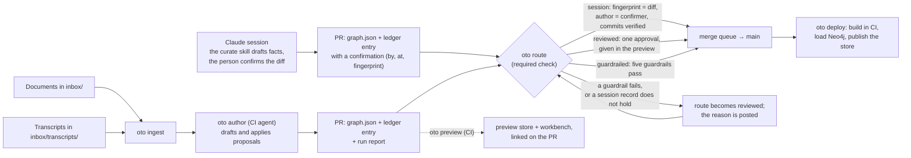

# Plan: three routes into main, one gate, and the graph published on merge

People add to a knowledge graph in three ways. A product owner works in a Claude session and
confirms each change there. An architect drops documents in the inbox and reviews what the
pipeline drafted from them. A manager's meeting transcripts arrive on their own and should land
without anyone looking, as long as guardrails hold. Today the engine gives all three the same
pipeline into `main` (ingest, author, checks, deploy, written by `oto init --repo`) and the same
approval: a pull request someone merges. What differs between the three is **who approves, and
what must be true before the merge**, and nothing in the engine or the repository says it.

This plan gives every change a **route**, decided by what the pull request carries, and one
**route gate**, a required status check that enforces the route's rule. A change confirmed in a
session merges on its own, bound to what the person saw by a fingerprint. A change drafted from
documents waits for one approval in a preview of the graph. A change drafted from transcripts
merges when five guardrails pass, and goes to a person when one fails. Every route ends the same
way: the merge builds the store in CI and publishes it. The decisions this plan rests on were made
on 2026-11-02 in the design note *Graph Contribution Journeys*: the person who makes a change in
their session approves it there and no other approval is needed; transcripts are put in the inbox
by a process designed later; each project has its own graph, repository and pipeline.

Status: proposed on 2026-11-02; phases 1 to 5 delivered on 2026-11-02 (pull requests 161 to 165, released as 0.17.0 under [ADR-0013](../adr/0013-three-routes-into-main.md)). Phase 6: the engine half (the routes' policy in the pack manifest, validated by `oto pack check` and printed by `oto pack show`; derived into the project at `oto init --pack` with `routes_from`; overridden key by key; re-derived by `oto ontology update`; read by the gate) delivered on 2026-11-02 (pull request 168); the skills half (the transcripts run in the pipeline's references, the routes in act, spec, sandbox, packs, start, the concierge, curate and the ontology interview) delivered on 2026-11-03.
Found while writing its end-to-end section (E2E-TESTING.md section 35), fixed on 2026-11-03: the gate read the policy at
the head, so a pull request could widen its own; it reads the base's now. Closed on 2026-11-03: the `oto route`
workflow runs on `pull_request`, so a pull request that rewrote it would have been judged by its own copy, and the rules
let GitHub Actions past them, so a workflow on any branch could push to main with its token. `.github/CODEOWNERS` now owns
`.github/` and `oto.lock.json` and the rules require a code owner's approval for them; the ingest and architecture
workflows push with a deploy key kept in the environment `oto-main`, which only main deploys from; that key and an
administrator, by a pull request, are the only ones past the rules (`oto repo rules --apply` sets all three up).

## What exists, and what changes

| Today | After this plan |
|---|---|
| `oto curate apply --by <who> --note` lands a candidate and appends a ledger entry: counts, retired facts, who, the note. | The entry may carry a **confirmation**: who confirmed, when, and the **fingerprint** of the fact-level diff they saw (`oto curate diff --json`, canonical). `oto curate apply --confirm` writes it; the session skills use it. |
| A pull request merges when its checks are green and someone presses the button; branch rules, when there are any, ask the same of every pull request. | Every pull request has a **route**: `session` (a confirmation covers the whole diff), `guardrailed` (drafted from `inbox/transcripts/`), else `reviewed`. One required check, **`oto route`**, enforces the route's rule; branch rules require only that check and `oto checks`, with zero approvals at the branch level. |
| Nobody approves a transcript's facts, or everybody does. | **Guardrails**, declared in `project.config.json` under `routes.guardrailed`, run on the fact-level diff: additive only, cited and attributed, in scope, clean, bounded. A failing guardrail moves the pull request to `reviewed` with the reason posted. |
| A diff of `graph.json` is what a reviewer sees. `oto preview` builds the live graph plus the candidate and every proposal, on a machine that has the branch. | **A preview per pull request**: CI builds the store at the head and publishes it with the workbench to the query repository's `preview/pr-<n>` branch (or as a workflow artifact), and comments the link. Approval on the `reviewed` route is given there. |
| The workflows install the engine from its repository's default branch; `oto.lock.json` records a version nobody checks in CI. | The workflows install the engine **at the ref the lock records**; an engine upgrade is a pull request that moves the lock. |
| Two pull requests that both touch `graph.json` conflict as text. | The repository uses GitHub's **merge queue**; a pull request that fell behind re-applies its proposals onto the new `main` through the gates (`oto route rebase`), and the fingerprint still holds because it is over facts, not bytes. |
| `oto init --repo` writes the workflows; branch rules are set by hand, or not at all. | `oto init --repo` writes the route workflow and the **branch rules** as a file; `oto sandbox up --repo` applies them with the token it already holds; `oto repo rules --apply` does the same later. |
| The capture skill records what someone said; a CI agent drafts facts from it later, which nobody confirmed. | In a session the **curate skill drafts the facts, shows the diff, and records the confirmation** at the fourth gate. Capture stays for a statement recorded without drafting; it travels the `reviewed` route. |
| The guardrail settings live in `project.config.json`, typed by hand per project; nothing says which routes a project may use. | **The pack carries the routes' policy** in its manifest, `routes`: which routes a project on it permits (`allowed`), the classes a session may touch without review, the guardrailed settings. It is **derived into the project** at `oto init --pack` and on `oto ontology update`, as the vocabulary is, and a project overrides it key by key; `oto status` says which keys are the pack's and which the project's. Which route a change takes stays derived from the pull request (phase 6). |

## Architecture

One pipeline, three routes, one gate. The route is a property of the pull request, derived from
what it carries, never declared by a label someone could set.



The engine learns three things: a confirmation in the ledger with a fingerprint of the fact-level
diff, a route computed from a pull request's content, and guardrails as a check over a diff. The
rest is the repository's: a workflow that feeds the gate what only GitHub knows (reviews, commit
verification, the author), branch rules, a merge queue, and the preview published where the
existing deploy already publishes.

## The record, the fingerprint and the route

**The fact-level diff.** `oto curate diff` already says what a candidate changes. `--json` makes it
canonical: nodes added, removed and changed, edges added and removed, each item sorted by id, each
node and edge serialised with sorted keys and without volatile fields (timestamps the apply sets).
The **fingerprint** is sha256 over that JSON. It is the same whether the diff is taken between a
live graph and its candidate on a laptop, or between `graph.json` at the base commit and at the
head commit in CI, as long as the facts are the same: so a confirmation given in a session can be
checked by a machine that never saw the session.

**The confirmation.** `oto curate apply --by <person> --note <why> --confirm` appends the usual
ledger entry (`changelog.jsonl`) with one more field:

```json
"confirmation": {"by": "chiheb@cynergis.ai", "at": "2026-11-02T18:40:11", "fingerprint": "3f9c…", "shown": "diff"}
```

`by` is the identity git will see as the committer (the email, or a GitHub login the route
workflow resolves); `shown` says what the person saw, the diff. A confirmation is never written by
a CI agent: the author workflow applies with `--by "oto pipeline"` and no `--confirm`, and the route
gate refuses a confirmation whose `by` is not the pull request's verified author.

**The route**, computed by `oto route show --base <ref> [--head <ref>]` from the two trees:

| Route | When | What must hold at the gate |
|---|---|---|
| `session` | the ledger entries added between base and head all carry a confirmation, and the fingerprint of the fact-level diff `graph.json@base → graph.json@head` equals the confirmation's | the confirmer is the pull request's author, every commit is verified (signed), the `oto checks` are green |
| `guardrailed` | the ingest runs the pull request carries came from `inbox/transcripts/` only, and no entry carries a confirmation | the five guardrails pass on the fact-level diff (`oto route guardrails`), the checks are green |
| `reviewed` | everything else: documents, a capture drafted later, a session record that does not hold, a guardrail that failed | one approving review on the pull request, the checks are green |

A pull request's route can only move towards `reviewed`: a failing session record or guardrail
sends it there with the reason as a comment and a label (`oto-route:reviewed`), and a person
decides. Nothing moves the other way.

**The guardrails**, for the `guardrailed` route, declared once per project:

```json
"routes": {"guardrailed": {"from": "inbox/transcripts/", "classes": ["Decision", "Blocker", "Card"],
                           "max_facts": 40, "additive_only": true, "attributed": true}}
```

| Guardrail | What `oto route guardrails` checks on the diff |
|---|---|
| Additive only | no node removed or changed, no edge removed, no fact superseded: a contradiction with the live graph is a person's call |
| Cited and attributed | every added node is a human assertion (`source_type: human_assertion`, its sources an `assertion:<id>` of the assertions log) whose entry names the speaker and cites a document under `inbox/transcripts/`; never a fact that reads as established |
| In scope | every added node's class is in `classes`; the vocabulary files are untouched (a derived vocabulary cannot change here anyway) |
| Clean | the ingest run was made with `--strict-privacy` (the manifest records it) and the transcript's hash is not in an earlier run |
| Bounded | the number of added facts is at most `max_facts` |

## Folder structure

Nothing new in the project's layout beyond one workflow, one rules file and a field in the config.
The ledger carries the confirmations; the run manifests already say where a document came from.

```
board/                                   # a knowledge project, kind knowledge (ADR-0012)
  project.config.json                    # + "routes": the routes' policy, derived from the pack (routes_from says which keys); overridable
  oto.lock.json                          # the engine ref the workflows install
  changelog.jsonl                        # the ledger; an entry may carry "confirmation"
  graph.json                             # the live graph
  assertions.jsonl                       # statements by a person; a transcript's facts are the speaker's assertions
  proposals/                             # one file of proposed facts per document, committed with the run
  inbox/                                 # documents: the reviewed route
  inbox/transcripts/                     # transcripts: the guardrailed route
  build/documents/                       # the corpus, committed with each run
  .github/workflows/
    oto-ingest.yml  oto-author.yml  oto-review.yml  oto-checks.yml  oto-deploy.yml  oto-tools.yml   # today
    oto-route.yml                        # the gate: computes the route, feeds it what GitHub knows, posts the verdict
    oto-preview.yml                      # on a pull request: the store at head, published or kept, linked in a comment
  .github/oto-rules.json                 # the branch rules `oto repo rules --apply` sets: PRs required, the two checks, zero approvals, merge queue on
```

## Flows

### The product owner: a change confirmed in the session

1. In a knowledge sandbox on the board's project, the person says what happened: a card is blocked
   on the platform team. The **curate skill** reads it back, drafts the card, the move and the
   blocker as a proposal, checks it against the board (the second gate finds a contradiction, if
   any), and shows the fact-level diff in plain terms.
2. The person confirms. The skill runs `oto curate apply --by <person> --note <why> --confirm`: the
   graph changes, the ledger entry carries the confirmation and the fingerprint.
3. The skill commits with the person's git identity (verified commits: the sandbox's git is set up
   to sign, see the open questions), pushes a branch, opens the pull request, turns on auto-merge.
4. `oto route` computes `session`, recomputes the fingerprint from the two `graph.json`, compares,
   checks the confirmer is the author and the commits are verified. Green with `oto checks`, the
   pull request enters the merge queue; if `main` moved, `oto route rebase` re-applies the
   proposals and the fingerprint still matches; the merge runs `oto deploy`, which builds and
   publishes. Nobody else approved anything, and the record says who did.

### The architect: documents, a preview, one approval

1. Documents go into `inbox/`; `oto ingest` and `oto author` run as today and open the pull
   request with the run report.
2. `oto preview` runs in CI on the head: the store and the workbench are published to the query
   repository's `preview/pr-<n>` branch (or kept as an artifact when the project has no query
   repository) and the link is posted on the pull request.
3. The architect reads the new systems, components and decisions as pages and as a graph, asks
   for changes with `@claude` if needed (the review workflow revises on the branch, and the preview
   is rebuilt), and approves.
4. `oto route` computes `reviewed`, sees the approval, passes; merge, deploy, publish. An architect
   who drafts the same facts in their own session takes the session route like anyone else.

### The manager: transcripts under guardrails

1. A transcript lands in `inbox/transcripts/` (how it gets there is decision 2, designed later).
   Ingest runs with `--strict-privacy`; the author run records each speaker's statements in the
   assertions log and drafts the facts as **the speaker's assertions**, each citing the transcript,
   and opens the pull request.
2. `oto route` computes `guardrailed` and runs `oto route guardrails`. All five pass: the pull
   request merges on its own and is published. One fails: the route becomes `reviewed`, the failing
   guardrail and the facts it caught are posted, and a person decides. The transcript is not lost.

### Every project

Build in CI only, publish on merge, the engine pinned by the lock, the merge queue serialising
`graph.json`: these hold for every route and are the repository's shape, written once by
`oto init --repo` and applied by `oto sandbox up --repo` or `oto repo rules --apply`.

## Engine changes, by phase

Each phase is a pull request of the engine (and where noted, of the skills in it), tests first.

**Phase 1, the fact-level diff and the confirmation.**
- `oto curate diff --json`: the canonical diff (sorted, volatile fields out); `oto/curate/diff.py`
  gains `canonical(diff)` and `fingerprint(diff)`. The same function computes the diff between two
  graph files (`oto curate diff --from-graph <base.json> --to-graph <head.json>`), so CI and the
  session hash the same thing.
- `oto curate apply --confirm`: the ledger entry carries `confirmation` (`by`, `at`, `fingerprint`,
  `shown`); refused without `--by`; `oto curate log` shows it. `oto audit` keeps chaining the entry
  as it does.
- Tests: `tests/test_curate_fingerprint.py` (the same facts hash the same from a candidate and from
  two graph files; a reordered file hashes the same; a changed fact does not; the ledger entry).

**Phase 2, the route and its gate.**
- `oto route show --base <ref> [--head <ref>] [--json]`: reads the two trees with git, finds the
  ledger entries added, the ingest runs carried and where their documents came from, and says the
  route and why. `oto route check --base <ref> --author <identity> [--approved] [--verified]`: the
  verdict for the route, exit 0 or 1, the reasons in words; the GitHub-only facts (reviews, commit
  verification, the author) come in as flags, so the engine never calls GitHub.
- `oto init --repo` writes `oto-route.yml`: on `pull_request` and `pull_request_review`, computes
  the flags with `gh` (`gh pr view --json reviews,author,commits`), runs `oto route check`, posts
  the verdict as the check and, on a failing session record, labels the pull request and comments
  the reason. It also writes `.github/oto-rules.json` (pull requests required on `main`, the
  checks `oto route` and `oto checks` required, zero approvals, the ingest bot allowed to push its
  run commit, merge queue on) and `oto repo rules --apply` sets them through `gh api`; `oto sandbox
  up --repo` applies them right after it creates the repository, with the token it holds.
- Tests: `tests/test_route.py` on small git repositories built in the test (a confirmed change
  whose fingerprint holds, one where a byte changed after the confirmation, a documents run, a
  transcripts run); `tests/test_repo.py` for the new files; `tests/test_sandbox.py` for the rules
  step, `gh` faked as it is already.

**Phase 3, the guardrails.**
- `project.config.json` gains `routes.guardrailed` with the settings above; `oto status` says the
  route settings when there are any; `oto route guardrails --base <ref>` runs the five checks on
  the fact-level diff and names what each caught.
- The author run, on a transcripts run, records assertions (`oto curate assert --by <speaker>
  --from <transcript>`) and drafts the facts as those assertions: the skill's prompt says so, and
  `oto curate check` refuses a node from a transcript that is not a human assertion when the route
  settings ask for attribution. The ingest manifest gains `strict_privacy`; it records the
  documents' hashes already (the Clean guardrail reads both).
- `oto-route.yml` escalates: on a failing guardrail the label `oto-route:reviewed` and a comment
  with the findings; the route then requires an approval.
- Tests: `tests/test_route_guardrails.py`, one case per guardrail, and the escalation in
  `tests/test_route.py`.

**Phase 4, the preview and the pinned engine.**
- `oto-preview.yml`: on a pull request, build the store at the head (`oto build`, `oto preview`),
  publish it with the site to `preview/pr-<n>` of the query repository when `OTO_QUERY_REPO` is set
  (`oto publish --branch preview/pr-<n> --site`), else keep it as an artifact; comment the link;
  on close, delete the branch.
- The workflows install the engine at the lock's ref: `oto lock --engine-ref` prints it, and the
  templates use it in place of the default branch; `oto lock --check` runs in `oto checks` so drift
  between the lock and the installed engine fails the pull request.
- `oto route rebase`: for the merge queue, re-apply the pull request's proposals (the ledger entry
  names them; they are committed under `proposals/` with the run) onto the new `main` through the
  gates, and say whether the fingerprint still holds.
- Tests: `tests/test_repo.py` for the templates; `tests/test_lock.py` for `--engine-ref`;
  `tests/test_route.py` for `rebase` on a moved base.

**Phase 5, the skills, the documents and the decision.**
- The `curate` skill: at the fourth gate, `apply --confirm` with the person's identity, then the
  branch, the pull request and auto-merge, in the person's words. The `capture` skill says a
  capture travels the reviewed route and offers to draft instead. `build-knowledge-base` and
  `concierge` name the routes where they explain what happens after a change.
- ADR-0013: a change enters `main` by one of three routes, decided by what it carries; one gate
  enforces the route; the person who confirms in a session is the approval.
- `docs/ARCHITECTURE.md` (the routes, the confirmation, the gate), `docs/E2E-TESTING.md` (a section
  driving the three routes on a repository), `README.md`.
- A release.

**Phase 6, the routes as the pack's defaults, and the skills that still say nothing.**

The guardrail settings are domain knowledge: which classes a transcript may add unattended, how
many facts a run may carry, whether a contradiction is ever allowed. The pack author knows that a
Kanban board tolerates cards and blockers from a transcript and never a decision's status. So the
pack carries the routes' *policy*, and the project derives it the way it derives the vocabulary
(ADR-0012). What the pack never carries is *which route a change takes*: that stays derived from
what the pull request carries (ADR-0013), because the gate's trust comes from the record, a
confirmation whose fingerprint is the diff or a run whose manifest names the transcripts folder,
and a setting that chose the route would put a label where a fact-level check is.

- **The manifest.** `manifest.json` gains `routes`, the same shape as the project's, with one more
  key:

  ```json
  "routes": {
    "allowed": ["session", "reviewed", "guardrailed"],
    "session": {"classes": ["Card", "Blocker", "Column", "Move"]},
    "guardrailed": {"from": "inbox/transcripts", "classes": ["Decision", "Blocker"], "max_facts": 40,
                    "additive_only": true, "attributed": true}
  }
  ```

  `allowed` says which routes a project on this pack may use; a pack that drops `guardrailed` sends
  every transcript to a person. `session.classes`, optional, is a scope guardrail on the session
  route: a confirmed change that adds or changes a class outside the list goes to a reviewer, so a
  product owner moves cards on their own word and a decision's status still gets a second pair of
  eyes. `oto pack check` validates the section: the routes named exist, the classes are classes the
  pack composes, `max_facts` is a positive integer, `from` is a folder of the project; the
  publishability scan reads it like the rest. `oto pack show` prints it. (`FIELDS` and
  `_manifest_problems` in `oto/model/packs.py`.)
- **Derived into the project.** `oto init --pack` writes `routes` into `project.config.json` from the
  pack, and records beside it `routes_from`: the pack, its release and the keys taken
  (`{"pack": "kanban", "release": 3, "keys": ["allowed", "session", "guardrailed"]}`). A project
  overrides a key by writing it: the key leaves `routes_from.keys` and is the project's from then
  on. `oto ontology update` rewrites the keys still listed from the pack's new release and leaves
  the project's alone, saying what moved. Two packs composed: `allowed` is the intersection (the
  stricter wins), the settings come from the first pack named, and a second pack that declares them
  too is reported, not merged. A project with no pack, or on a pack without `routes`, keeps today's
  behaviour: no section, every pull request reviewed, settings typed by hand. (`oto/model/derived.py`
  gains the routes beside the vocabulary; `oto/scaffold.py`, `oto/cli/catalog.py`.)
- **The gate reads the policy.** `oto route show` and `check` read the effective `routes` at the
  base, never at the head, so a pull request is not judged by a policy it rewrites; one that rewrites
  `routes`, moves `oto.lock.json` or touches `.github/` goes to `reviewed`, measured from the merge
  base so a stale branch is not taken for one. A route not in `allowed` moves to `reviewed` with the reason ("the pack kanban does not
  allow the guardrailed route"); a session change touching a class outside `session.classes` moves
  to `reviewed` ("Decision is not a class a session changes without review on this pack"). The
  guardrails read their settings as they do. `oto status` says `routes  from kanban @3 (allowed,
  session, guardrailed); guardrailed overridden here`. (`oto/route.py`, `oto/cli/status.py`.)
- **The skills that still say nothing.** Found by reading each skill that ends in a change on
  `main`:
  - `build-knowledge-base/references/pipeline-run.md`, the document the author agent follows
    *exactly* in CI: a section for a transcripts run (record each speaker's statements with `oto
    curate assert`, draft their assertions, only the allowed classes, additive, within `max_facts`,
    what the report says), and a line on the route the pull request will take; today the rules are
    in the workflow's prompt and not in the reference.
  - `build-knowledge-base/references/draft-proposal.md`: a fact from a transcript is the speaker's
    assertion, with the shape.
  - `act`: the tools workflow's pull request is `reviewed`; a person acting in their session and
    recording the response applies with `--confirm`, the session route.
  - `spec`: a decision recorded from a session applies with `--confirm`; one drafted by the pipeline
    from an ADR in the inbox is `reviewed`.
  - `sandbox`: a knowledge sandbox's repository gets the branch rules when it is created, and the
    pack's routes come with the project; say it in the read-back.
  - `packs`: `oto pack show` prints the routes; a pack without them leaves every pull request to a
    reviewer.
  - `start` and `concierge`: the routes line says where the policy came from.
  - Tests: `tests/test_skills_routes.py` extended with the words each must say; `tests/test_packs.py`
    for the manifest's validation and `show`; `tests/test_project_kind.py` for the derivation, the
    override and `update`; `tests/test_route.py` for `allowed` and `session.classes` at the gate.
- A release.

## What the Northwind Kanban project needs, apart from this plan

These are the repository's settings, not engine changes, and they block the journeys today:

- the repository secret `ANTHROPIC_API_KEY`, without which the author and review workflows cannot
  run, so the card captured on 2026-11-02 has no pull request;
- branch rules on `main`, which is unprotected: until phase 2 writes them, `gh api` sets them by
  hand;
- the engine the workflows install, which drifts from the lock (phase 4 pins it; until then, the
  lock is moved to what CI installs);
- a graph server: `NEO4J_URI` is unset, so a merge builds the store and publishes it nowhere.

## What does not change

The four curate gates and the candidate as the only way into the graph; the ledger as the record
and the audit chain over it; the build, the stores and the deploy workflow; the derived vocabulary
and the two kinds of project (ADR-0012); the engine's one vocabulary (ADR-0011). A project that
never writes `routes` and never confirms in a session has every pull request on the `reviewed`
route, which is what it has today.

## Open questions

- **Verified commits from a sandbox.** The session route trusts a confirmation only when the
  commits are verified and authored by the confirmer. A sandbox pushes with the sandbox tool's
  GitHub secret and a generic git identity today. Decide how a person's identity and signing key
  reach the sandbox (a per-person secret the sandbox tool holds, or GitHub's web-flow signing
  through the API), or whether the route accepts an unsigned commit whose author the token's owner
  vouches for.
- **Retention of transcripts.** The corpus is committed with each run, so a transcript's text
  stays in git history. Decide whether transcripts may live there at all, or only redacted
  extracts, before the guardrailed route is used with real meetings.
- **The guardrail settings.** Which classes transcripts may add, and the size of a run, are the
  project's to set; the engine ships no default beyond `additive_only` and `attributed` on.
- **How transcripts arrive** in `inbox/transcripts/` (decision 2): a connector, a scheduled tool, a
  person. Designed later; the route does not depend on it.
- **A stricter project, a looser pack.** A project may drop a route the pack allows; may it allow
  one the pack does not? Phase 6 says no (the intersection), since the pack author knows the domain
  and the project owner knows the client, and the stricter of the two should hold until the two
  agree in a release. Decided when the first project asks for it.
- **Who re-applies a stale pull request.** `oto route rebase` runs in the working tree and commits
  nothing: an automatic re-apply would be a bot's commit, and the session route trusts a
  confirmation only on commits by the confirmer. So the person, or the curate skill in their
  session, runs it and pushes; the merge queue's strict checks then see an up-to-date branch.
