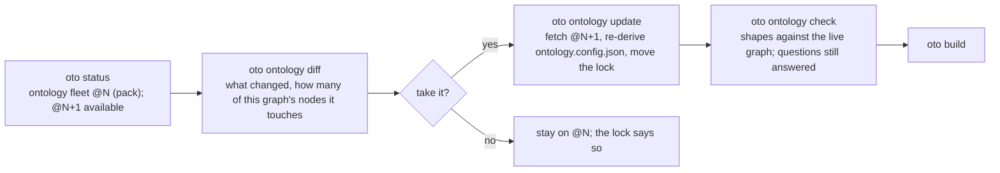
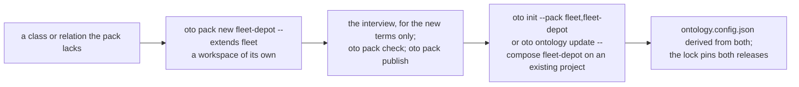

# Plan: the ontology workspace and the knowledge project, two kinds of project

An ontology is made once and used many times. Today both happen in the same place: a knowledge
project holds the vocabulary files beside its graph, the ontology-interview skill writes them there,
`oto ontology export` copies them out as an ontology whose sample is that project's own graph, and
every other team starts from the copy. The ontology has no home of its own, and the project that
happens to hold it mixes two concerns: deciding what the words are, and saying what is true in them.

This plan gives the ontology its own kind of project, the **ontology workspace**, whose deliverable
is a pack, and narrows the **knowledge project** to using packs: its vocabulary is derived from the
packs it composes and is not edited in place. The registry stays the contract between the two. The
engine, which builds, curates, deploys and manages ontologies and defines none (ADR-0011), gains
nothing domain-shaped: a project kind, a derived vocabulary, a trial project inside a pack, and a
sandbox that knows which kind it opens on.

Status: proposed on 2026-11-01. Phase 1 (the kind and the derived vocabulary) and phase 2 (the workspace: `oto pack new`
as a workspace, `check --strict`, `try`, publish leaving the trial behind) delivered on 2026-11-01; the rest is not built.

## What exists, and what changes

| Today | After this plan |
|---|---|
| One kind of project. The vocabulary files live beside the graph and are edited there. | Two kinds, recorded in `project.config.json`: `ontology` (a workspace, its deliverable a pack) and `knowledge` (a graph on packs). The default stays `knowledge`. |
| The ontology-interview skill writes the vocabulary into whatever project is open. | It works in an ontology workspace, writing the pack's `ontology/<name>/` files, and reads sample documents from the workspace's trial project. |
| `oto ontology export` copies a project's vocabulary out, taking the project's graph as the sample and emptying the confirmations. | The sample is authored in the workspace, small and illustrative. `export` stays as the bridge for a project that grew a vocabulary before this plan: it opens a workspace from it (`oto pack new --from-project`). |
| `oto pack new` scaffolds a pack from an ontology already on the machine. | `oto pack new` scaffolds the workspace: the pack, a trial project composing it, a check workflow. `oto pack check` runs the vocabulary's three strict gates on the embedded ontology. `oto pack try` builds the trial project from the pack and answers its questions. |
| A knowledge project's `ontology.config.json` is the project's own; `oto init --pack` writes it once. | Derived: regenerated from the packs the lock pins. Editing it is refused by `oto ontology check` unless the project says it owns its vocabulary. A team that needs a term makes a pack that extends. |
| `oto status` says a newer release exists; `oto ontology diff` shows it; `oto ontology update` re-fetches. | Unchanged, and now the whole update path: `update` re-derives the vocabulary from the new release, then `check` and `build`. |
| The build-knowledge-base skill has a phase for changing the vocabulary. | That phase points at the workspace. The skill composes packs and authors facts. |
| A sandbox opens on a folder; the person chooses what to do there. | `oto sandbox up --kind ontology|knowledge`, with a GitHub repository created for the project by default (a token attached to the sandbox), `--no-repo` to skip it; the sandbox skill proposes the sandbox name, the folder and the repository name from one answer. |

## Architecture

Three places, two kinds of project, one contract.

```mermaid
flowchart LR
  subgraph workspace["Ontology workspace (kind: ontology) — one git repository per ontology"]
    direction TB
    pack["pack/<br/>manifest.json<br/>ontology/&lt;name&gt;/ (terms, rationale, questions, rules, sample)<br/>skills/ views/ tests/"]
    trial["trial/<br/>a knowledge project composing the pack:<br/>sample documents in, questions answered"]
    trial -- "the interview reads documents, writes terms" --> pack
    pack -- "oto pack try" --> trial
  end
  registry[("Registry<br/>Cynergis/oto-registry<br/>index, marketplace, tags, pack tests")]
  subgraph kb["Knowledge project (kind: knowledge) — one per graph"]
    direction TB
    lock["oto.lock.json<br/>packs pinned at a release"]
    vocab["ontology.config.json (derived, read-only)"]
    graph["inbox → corpus → proposals → gates → graph.json → build → store"]
    lock --> vocab --> graph
  end
  pack -- "oto pack check, oto pack publish (release N)" --> registry
  registry -- "oto pack add / init --pack / ontology update (release N → N+1)" --> lock
  engine["Engine (oto)<br/>builds, curates, deploys, manages;<br/>defines only oto-core"]
  engine -. runs in .-> workspace
  engine -. runs in .-> kb
  engine -. publishes to, fetches from .-> registry
```

The engine knows one new fact about a project, its kind, and one new rule, that a knowledge
project's vocabulary is derived. Everything else it does already: the pack layout, the embedded
copies of the bases, the strict checks, the registry, the lock, the diff on a new release.

## Folder structure

### An ontology workspace

One git repository per ontology. The pack is the deliverable and is what `oto pack publish` copies;
the trial project and the workflows stay behind.

```
fleet-ontology/                         # the repository; `oto pack new fleet` lays it out
  manifest.json                         # the pack: name, release, domain, summary, engine, maintainer,
                                        #   the ontology it embeds, carries, provides (if it has code), changelog
  README.md                             # what the pack is for, written by the author
  ontology/
    fleet/                              # the deliverable, the four files and what rides with them
      manifest.json                     # name, release, extends, namespace, engine, carries
      ontology.config.json              # classes, relations, attributes, shapes
      ontology.rationale.json           # why each exists, alternatives considered, who confirmed it
      questions.json                    # what the graph must answer; every term cited by one
      rules.json                        # derive and policy rules (optional)
      sample.graph.json                 # a small illustrative graph: every question answers from it
      README.md  guide.md  lexicon.json # how to read a graph in this vocabulary (optional)
      code/                             # the pack's own Python, when its manifest provides a command, stage or tool
    software-architecture/ ... oto-core/   # the bases it extends, embedded at the releases it was checked with
  skills/
    start/SKILL.md                      # generated: start a project from this pack
    <skill>/SKILL.md                    # the author's: how to use this vocabulary
  views/<view>/                         # apps for the studio (optional)
  tests/                                # pytest against the engine, as the registry's pack tests run them
  trial/                                # a knowledge project composing this pack, never published
    project.config.json                 # kind: knowledge, ontology: fleet from ../ (a path)
    inbox/ processing/ archive/ ...     # the sample documents the interview read
    proposals/ graph.json build/        # the facts tried against the vocabulary
  .github/workflows/
    pack-check.yml                      # on every pull request: oto pack check, tests/
    pack-publish.yml                    # on a tag or a merge to main: oto pack publish --to the registry
```

### A knowledge project

Unchanged in shape. Two things change in meaning: the lock pins packs, and the vocabulary is derived.

```
northwind-kb/                           # `oto init --pack fleet --project northwind-kb`
  project.config.json                   # kind: knowledge; ontology: fleet @N, origin pack, pack fleet
  oto.lock.json                         # the engine, the packs at their releases, the marketplaces
  .claude/settings.json                 # the packs enabled for this project, so a session opens with them
  ontology.config.json                  # DERIVED from the packs in the lock: composed, read-only
  ontology.lock.json                    # the accepted baseline `oto ontology diff` compares against
  inbox/ processing/ archive/ runs/     # documents in, through ingest
  proposals/                            # one proposal per document, through the gates
  graph.json  graph.previous.json  changelog.jsonl  audit.jsonl
  build/                                # the store, the documents, the site
  oto.deploy.json                       # where the graph goes: the store repository and its environments
```

A knowledge project may still own its vocabulary, for the cases this plan does not want to break: a
one-off graph, or a project made before this plan. It says so (`"vocabulary": "own"`), and then the
files are the project's, as today. The default for a project started from a pack is `derived`.

## Flows

### The ontology team: from questions to a release

```mermaid
sequenceDiagram
  participant A as Author (with the ontology-interview skill)
  participant W as Workspace (pack + trial)
  participant E as Engine
  participant R as Registry
  A->>E: oto pack new fleet --domain operations [--extends software-architecture]
  E->>W: manifest, ontology/fleet/ (empty terms, the bases embedded), skills/start, trial/, workflows
  A->>W: sample documents into trial/inbox; oto ingest run --project trial
  A->>A: the interview: questions first, then classes, relations, attributes, rules, shapes
  A->>W: writes ontology/fleet/{ontology.config,ontology.rationale,questions,rules,sample.graph}.json
  A->>E: oto pack check .
  E-->>A: check --strict, rationale --strict, the sample answers every question, publishability, manifest shape
  A->>E: oto pack try .
  E->>W: trial/ re-derived from the pack, built; every question asked against the sample and the trial graph
  A->>W: git commit; pull request → pack-check.yml
  A->>E: oto pack publish --to the registry --note "..."
  E->>R: release N: packs/fleet, index, marketplace, tag fleet--vN.0.0
```

What touches what: the interview writes the pack's files and nothing in the trial project but its
documents and proposals. `oto pack check` reads the pack. `oto pack try` writes the trial project's
vocabulary from the pack, the one place a derived vocabulary is written. `publish` copies the pack
and skips `trial/` and `.github/`.

### The graph team: from a pack to a deployed graph

```mermaid
sequenceDiagram
  participant T as Team (with the build-knowledge-base skill)
  participant R as Registry
  participant K as Knowledge project
  participant E as Engine
  T->>E: oto pack add fleet   (or /oto:packs, or claude plugin install fleet@cynergis --scope project)
  E->>R: fetch fleet @N
  T->>E: oto init --pack fleet --project northwind-kb [--repo]
  E->>K: project.config.json (kind knowledge, ontology fleet @N, pack fleet), oto.lock.json, ontology.config.json derived, .claude/settings.json
  T->>K: documents into inbox; oto ingest run
  T->>K: one proposal per document, quoting it; oto curate start / add / check / apply
  T->>E: oto build; oto ingest complete; oto query ask <the pack's questions>
  T->>E: oto deploy init; oto publish --to dev --source <repo>@<commit>; promote
```

What touches what: nothing in this flow writes the vocabulary. `oto ontology check` on a knowledge
project with a derived vocabulary compares the file with what the lock's packs compose and refuses
a difference ("the vocabulary is the pack's: change it in the fleet workspace, or make a pack that
extends it"). The questions the team asks are the pack's; the gold set, the lexicon and the rules the
team adds are the project's.

### A new release reaches a graph



### A team needs one more term



The composition rule holds as today: a pack widens a relation of its base, never redefines a class,
and a relation name declared twice with two meanings is a composition error.

### A sandbox, for either kind

```mermaid
sequenceDiagram
  participant P as Person (with the sandbox skill, in Claude Desktop)
  participant S as oto sandbox
  participant G as GitHub
  participant B as Sandbox
  P->>S: /oto:sandbox → one answer: the name; the skill proposes folder and repository names, each editable, "no repository" as a checkbox
  P->>S: oto sandbox up --name fleet --kind ontology --repo acme/fleet-ontology --github-token-env GITHUB_TOKEN
  S->>G: create acme/fleet-ontology (empty, private), with the token the person named
  S->>B: create the sandbox from the kit; the token enters as a secret for gh and git, never written to a file
  S->>B: oto pack new fleet --repo acme/fleet-ontology (kind ontology) · or oto init --pack ... --repo (kind knowledge)
  B->>G: first push: the workspace or the project with its workflows
  P->>B: Claude Desktop over SSH; the skill that leads is chosen by the kind
```

`--no-repo` skips the GitHub steps and the token; the project is then local to the folders, as today.
The token is read from an environment variable the person names and is passed to the sandbox the way
the Anthropic approval is: through the sandbox tool, never into a file in the folders.

## Engine changes, by phase

Each phase is a pull request of the engine (and where noted, of the skills in it), tests first.

**Phase 1, the kind and the derived vocabulary.**
- `project.config.json` gains `kind` (`knowledge`, `ontology`; `concierge` already exists) and
  `vocabulary` (`derived`, `own`). `oto init --pack` and `oto init --ontology <a pack's name>` write
  `derived`; `oto init` with no ontology, `--ontology <a directory>` and existing projects read as `own`.
- `oto/model/vocabulary.py` (or a new `oto/model/derived.py`): `derive(project)` composes the
  vocabulary from the packs the lock pins, in order, and writes `ontology.config.json` with a header
  saying it is derived and from what. `oto ontology check` on a derived project compares and refuses
  a hand edit, naming the workspace. `oto ontology update` re-derives after fetching.
- `oto status` says `vocabulary derived from fleet @N` or `own`.
- Tests: `tests/test_project_kind.py` (the record, the refusal, the re-derivation), additions to
  `tests/test_registry.py` for `update` re-deriving, `tests/test_e2e_core.py` unchanged (its project
  owns its vocabulary: that is the hand-written case).

**Phase 2, the workspace.**
- `oto pack new <name> [--extends <pack,...>] [--domain] [--from-project <dir>]` lays out the
  workspace above: an empty-but-valid vocabulary when no `--ontology` is given (today it requires
  one on the machine), the bases embedded, `trial/` as a knowledge project composing the pack by
  path, the two workflows. `--from-project` is the bridge: today's `oto ontology export` plus the
  layout.
- `oto pack check` runs, on the embedded ontology, what `oto ontology check --strict`, `rationale
  --strict` and the publishability scan run, and asks every question against the sample.
- `oto pack try` re-derives `trial/`'s vocabulary from the pack, builds it, asks every question against
  the trial graph, and reports what the trial answers that the sample does not.
- `oto pack publish` skips `trial/`, `.github/` and `tests/` is kept (the registry runs them).
- Tests: `tests/test_pack_workspace.py`; `docs/E2E-CORE.md` step 7 becomes the workspace flow
  (`pack new` on the garage vocabulary, `check`, `try`, `publish`), and the script with it.

**Phase 3, the skills.**
- `ontology-interview`: opens in a workspace (or offers to make one with `oto pack new`), reads
  `trial/`'s documents, writes `ontology/<name>/`, closes with `oto pack check` and `oto pack try`.
- `build-knowledge-base`: Phase 2 ("the vocabulary") becomes "the packs": which pack, `oto pack add`,
  `oto init --pack`; a missing term is a note to the workspace, not an edit.
- `concierge` and `start`: route by `kind`; `packs`: unchanged; `spec`, `curate`, `query-knowledge`:
  unchanged.
- Tests: the skill-reading tests the engine has (`test_concierge.py`, `test_packs_skill.py`) extended
  for the words the skills must now say.

**Phase 4, the sandbox.**
- `oto sandbox up --kind ontology|knowledge --repo <owner/name> | --no-repo --github-token-env <VAR>`:
  creates the repository with the token (through `gh repo create`, private by default), passes the
  token into the sandbox as the sandbox tool passes a secret, runs `oto pack new` or `oto init --repo`
  inside, pushes once. `--check` says what it would do. The kit's init script gains nothing: `gh` is
  there already.
- The `sandbox` skill: one question for the name; the folder (`~/<name>`) and the repository
  (`<github user or org>/<name>`) proposed and editable, a checkbox "no repository" that clears the
  repository; the kind as a second choice; read back and confirm; `--check` then `up`.
- Tests: `tests/test_sandbox.py` (the flags, the dry run, the repository step stubbed),
  `tests/test_sandbox_skill.py`.

**Phase 5, the documents and the decision.**
- ADR-0012: two kinds of project; a knowledge project does not define its vocabulary.
- `docs/ARCHITECTURE.md` (the two kinds, the derived vocabulary, the workspace), `docs/E2E-TESTING.md`
  (sections 4 and 15 rewritten around the workspace), `README.md`, the registry's README.
- A release (0.16.0: a project started from a pack now carries a derived vocabulary, which a project
  made before this plan keeps as its own).

## What does not change

The four curate gates, the build, the stores and the deploy; the pack layout and the registry; the
lock; the composition rules; the engine's one vocabulary, oto-core, and the rule that it defines no
other. A project made before this plan keeps working as it is: its vocabulary is its own until it
says otherwise, and `oto pack new --from-project` is the way to give that vocabulary a home.

## Open questions

- **The trial project's documents.** Sample documents often come from a client. The workspace is a
  repository the ontology team shares, so `oto publishable` runs in `pack-check.yml` over `trial/`
  too, and the skill asks before a document is committed. Decide whether `trial/inbox` is ignored by
  git by default.
- **Several packs, one lock.** A knowledge project composing two packs that both extend a third gets
  the base once, at the higher release; the lock records which pack brought it. Decide whether
  `update` of one pack may move a base the other pack pinned.
- **The repository name the sandbox proposes.** Derived from the sandbox name under the person's
  GitHub login or an organisation; the skill needs to know which. `gh api user` and `gh org list`
  can offer the choice.
