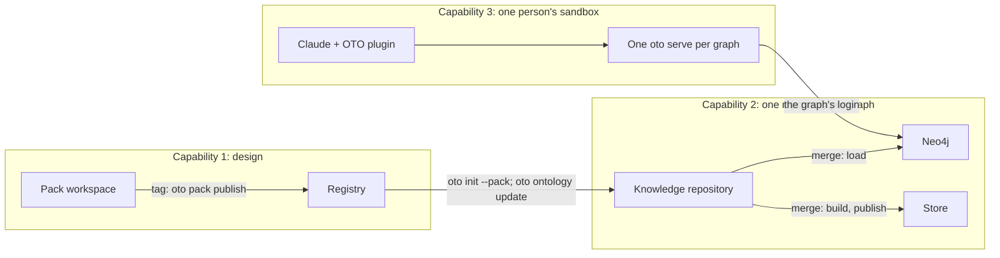

# Spec: people, permissions and many graphs

Status: proposed on 2026-11-04, and reviewed capability by capability that day. Nothing here is built unless
the last section says it exists. Commands marked *new* do not exist yet.

Three capabilities, and how to run them as a platform:

1. **An ontology is designed together, like code.** One or more people design a vocabulary and release
   it as a pack, through a GitHub repository.
2. **A person has permissions on a graph.** They may read it, contribute to it, or create one.
3. **A person uses many graphs.** One person asks questions across one or many graphs.

## The rules this spec rests on

1. **GitHub holds identity and permissions for changing a graph.** OTO has no user database. Proposing a
   change and approving one are GitHub permissions on a repository. Reading is different for now: it takes
   the graph's Neo4j login, and later a sign-in to its server.
2. **Git is the source of truth; every store is derived.** A lost store is rebuilt. The graph, its
   ledger and its vocabulary live in repositories.
3. **People should not hold a database credential.** That is the target, reached with the server on Cloud
   Run, when only the deploy workflow (to write) and the server (to read) hold one. Until then, a reader's
   sandbox holds a login for the graph's Neo4j, which is a decision with known risks (capability 3).
   Contributors should not reach the deploy secrets, and today they can: see "Who can reach the secrets".
4. **A graph is the unit of permission.** Who may read a graph reads all of it. What some readers must
   not see belongs in another graph, in another Neo4j instance if the same people mustn't reach it. The
   server could later filter inside a graph.
5. **Permissions are a file, reviewed like code.** This is the pattern branch rules already follow: a
   file in the repository, a command that applies it, a check that says when GitHub has drifted.
6. **A connection grants nothing.** Adding a graph to your sandbox works only with a login that graph accepts.

## The GitHub plan this assumes

The design works on GitHub **Team**, for private repositories. The plan decides what can be relied on:

| Feature, on a private repository | Team | Enterprise Cloud | How this spec uses it |
|---|---|---|---|
| Rulesets, required checks, code owners | yes | yes | branch rules on every repository |
| Environments restricted to a branch, with their own secrets | yes | yes | deploy secrets, reachable only from `main` |
| Required reviewers on an environment | **no** | yes | not relied on: promotion is approved by a pull request |
| Merge queue | **no** | yes | not relied on: up-to-date checks and `oto route rebase` |

The merge queue costs little to give up. A pull request that conflicts can't enter a queue either, so `oto
route rebase` is needed in both cases. What is lost is merging several ready changes in one go.

## The parts

| Part | What it is | Where it lives | How many |
|---|---|---|---|
| **Pack workspace** | where a vocabulary is designed; a trial project beside it | a GitHub repository | one per pack |
| **Registry** | released packs; also a Claude Code marketplace | a GitHub repository | one per organisation |
| **Knowledge repository** | one graph: documents, `graph.json`, ledger, routes, workflows | a GitHub repository | one per graph |
| **Neo4j** | the live graph, where people's answers come from; the deploy workflow loads it on every merge | your Aura account | one instance per access boundary |
| **Store** | a built, read-only copy, used for previews, promotion and offline work: the facts, and the documents' extracted text as passages, not the files | a query repository, one branch per environment | one per graph |
| **Graph directory** *new* | which graphs the organisation has, and how to reach them | inside the registry | one per organisation |
| **Graph connections** *new* | which graphs this person uses: a folder of connection settings per graph, and a server for each in `.mcp.json` | the project folder of the person's sandbox | one per graph |
| **Server on Cloud Run** (later) | `oto serve --http`, which alone holds the database login | your Google Cloud project | one per graph |



## Roles

Roles are per graph, or per pack. Each is a GitHub permission, plus what the route gate checks, except reading, which for now takes the graph's Neo4j login.

| Role | May | Needs |
|---|---|---|
| **Reader** | ask questions | the graph's Neo4j login, given by a steward; later, a sign-in to its server |
| **Contributor** | drop documents, propose changes, confirm their own facts in a session for the classes the pack allows | write on the knowledge repository |
| **Reviewer** | approve a change on the reviewed route | write, and named in the access file |
| **Steward** | change the routes, the engine pin, the workflows and the access file; approve promotion to production | code owner, which covers the promotion file |
| **Graph creator** | create a new graph from a released pack | may create repositories in the organisation |
| **Pack author** | propose changes to a vocabulary | write on the workspace |
| **Pack maintainer** | approve those changes; release the pack | code owner on the workspace; may push release tags |
| **Platform owner** | registry, engine upgrades, directory, organisation settings | organisation administrator |

A contributor can read the original files in the repository. A reader doesn't get the files, but Neo4j and the
store both carry their extracted text as searchable passages, so **a reader can read what the documents say**.

## Capability 1: an ontology designed together

### The experience

The first person creates the workspace:

```bash
oto sandbox up --name client-engagement --kind ontology --repo <org>/client-engagement --github-token-env GITHUB_TOKEN
```

A second person clones it:

```bash
git clone https://github.com/<org>/client-engagement
```

Or, to work in a sandbox, makes one from it (*new*; see below):

```bash
oto sandbox up --name client-engagement --clone <org>/client-engagement --github-token-env GITHUB_TOKEN
```

Then each of them follows the same workflow as for code:

1. Branch, and open Claude Code in the folder.
2. Run `/oto:ontology-interview` on one topic ("statements of work", "deliverables"). It writes the
   terms, the reason for each, who confirmed it, the questions the graph must answer, rules and a sample.
3. `oto pack check . --strict` and `oto pack try .` hold it to the gates.
4. Open a pull request. CI runs the gates and posts what changed, term by term, flagging what would
   break a graph already using the pack (*new*).
5. If `main` moved and the branch conflicts, run `oto pack rebase --onto origin/main` (*new*). It merges
   term by term and stops only on a real clash, such as two people defining one class differently.
6. A pack maintainer reviews and merges.
7. When enough has merged, a maintainer pushes a tag. The workflow runs `oto pack publish`, and every
   graph on the pack sees "release N+1 available".

### How it works

- **Already there:** the workspace layout, the gates, the required reason and named confirmation per
  term (`--strict`), the trial, and the release number raised at publish, so two pull requests never
  fight over it.
- **Where a release goes:** the organisation's registry. It is also a marketplace, so the pack's skills
  install with `claude plugin install <pack>@<registry>`. A pack fetched by URL brings the vocabulary
  but has no marketplace to install its skills from. `oto pack publish` to an empty repository creates
  the registry.
- **What can go wrong with a shared vocabulary:** a release that removes a class breaks every graph on
  it. Releases are plain numbers, so the check has to say what is breaking.

### Two authors today: the workflow runs, but it is not yet as easy as code

Tested on 2026-11-04 with two simulated authors, a local bare repository and hand-written edits rather than
the real interview. Both branched from one `main`, and each added a different class, relation, reason,
question and sample. A fresh clone passed `oto pack check --strict`, and the first branch merged cleanly.
The second **conflicted in all 6 files it touched**, though the two authors added unrelated terms:

| Cause | Files | Fix |
|---|---|---|
| New terms land at the same spot in each JSON file | 4 | canonical JSON: sorted keys, and the sample's nodes and edges in a stable order |
| `oto pack try` rewrites the trial's copies of the vocabulary and questions, which git tracks | 2 | stop tracking what `try` writes |
| Both authors take the next question number, `GQ3` | within `questions.json` | name questions by topic |

With those three fixes applied by hand, the same test conflicted in **1 file of 4**: `questions.json`, where
the two new questions sorted next to each other. Two inserts at one spot conflict in git whatever the format,
so sorting makes conflicts rarer without ending them.

That is what `oto pack rebase` is for. A term-level merge knows that two new terms never clash, and it reports
only what does: the same term changed on both sides. It follows `oto route rebase`, which re-applies a stale
pull request's facts onto a new `main`. A git merge driver would not do, because GitHub's merge button doesn't
run one.

Until then, these conflicts are additive and mean keeping both sides, by hand or with Claude.

### What to build

| Build | Why |
|---|---|
| Canonical JSON for the pack's files, written by the engine and held by `oto pack check` | two unrelated additions conflict in all four vocabulary files (see the test above) |
| The trial's generated copies untracked (`ontology.config.json`, `questions.json`, `rules.json`) | `oto pack try` rewrites them on every branch, so they conflict on every merge |
| Topic-named question ids, in the interview skill | the next number collides whenever two people add a question |
| `oto pack rebase --onto <ref>`: a term-level merge | the conflicts sorting can't prevent |
| `oto sandbox up --clone <repo>` (see capability 2) | a sandbox can't start from an existing repository in one step |
| The workspace declares the `oto` plugin at its root | only `trial/` declares it, so Claude Code doesn't offer the plugin to an author who opens the workspace |
| A workspace profile for `oto repo rules`: required check `pack check`, one approval, code owners on `ontology/` and `manifest.json`, release tags limited to maintainers | a workspace gets no branch rules today; anyone with write can push to `main` or tag a release |
| `pack-check.yml` runs `oto pack try`, pins the engine, and posts the term-level diff | it runs the check only, on an unpinned engine, with nothing for a reviewer to read |
| `oto pack check --against <release>`: names what is breaking | releases are integers with no breaking-change signal |
| A registry that accepts publishes by deploy key, as `main` already does on a knowledge repository | `publish_pack` pushes straight to the registry's branch, which branch rules would refuse |
| `trial/inbox` ignored by git by default | sample documents may be a client's (an open question in ADR-0012) |

## Capability 2: permissions on a graph

### Creating a graph

A graph creator runs this once. It makes the private repository, the layout, the workflows and the
branch rules:

```bash
oto sandbox up --name northwind-engagement --kind knowledge --pack client-engagement --repo <org>/northwind-engagement --github-token-env GITHUB_TOKEN
```

*New:* it also writes the access file naming the creator as steward, and creates the store repository
beside it.

### Who can do what: the access file

`.github/oto-access.json` (*new*) says who holds each role. Stewards own it, because `.github/` is
already under a code owner, so changing it is a pull request a steward approves.

```json
{
  "stewards":     ["team:<org>/northwind-stewards"],
  "reviewers":    ["team:<org>/northwind-reviewers"],
  "contributors": ["team:<org>/northwind-team"],
  "readers":      ["team:<org>/engagement-readers", "someone"]
}
```

`oto repo access --apply` (*new*) sets GitHub to match: repository permissions on both the knowledge
and store repositories, and `CODEOWNERS` from the stewards. `oto repo access --check` (*new*) reports
drift, on a schedule.

`readers` is only a record for now, of who was given the graph's Neo4j login: nothing applies or enforces it until the
server on Cloud Run.

None of this holds if the organisation's base permission is `read`, because every member can then read
every repository, documents included. Per-graph access needs a base permission of `none`, and `--check` says
so when it isn't.

### Joining a graph

There is no join command, because git and GitHub already do this. What a person runs depends on their role:

- **A reader** adds the graph's connection to their sandbox (capability 3).
- **A contributor on their own computer** clones the repository, then builds it so answers come from a local
  store. Claude Code offers the plugins the project declares, the session start checks the engine against the
  plugin, and `oto lock --check` compares the computer with the project's lock.

```bash
git clone https://github.com/<org>/northwind-engagement
```

```bash
oto build --project northwind-engagement
```

- **A contributor in a sandbox** makes one from the repository:

```bash
oto sandbox up --name northwind-engagement --clone <org>/northwind-engagement --github-token-env GITHUB_TOKEN
```

`--clone` (*new*) clones into `~/<name>/project` when that folder is empty, creates the sandbox over it,
installs the plugins the project declares, and stores the person's token as that sandbox's own GitHub secret.
It never pushes, never commits and never touches branch rules or deploy keys, and it refuses a folder that
already holds something else.

It is needed because `--repo` is built for the first person, and is unsafe on an existing repository. In an
empty folder it lays out a new project and tries to push it over the team's `main`. In a folder already cloned,
it runs `git add -A`, commits what it finds and pushes `main`, and on a knowledge repository it re-applies the
branch rules, which replaces the deploy key.

The same thing works by hand today, without `--clone`: `git clone` into `~/<name>/project`, then `oto sandbox up
--name <name>`, which reuses the folder, then `gh auth token | sbx secret set github --sandbox <name> -f`.

### Changing a graph

This is what ADR-0013 already defines, and it does not change. A contributor says what happened, the
curate skill shows the change and they confirm it. That change takes one of three routes:

| Route | Who approves | When |
|---|---|---|
| `session` | the contributor's own confirmation | they authored it, the commits are verified, and the classes are ones the pack allows |
| `guardrailed` | nobody, if five guardrails hold | facts drawn from transcripts |
| `reviewed` | a reviewer | everything else, and whatever fails the other two |

Two rules of this model are not true yet, and both are required:

1. **Reviewer means reviewer.** GitHub's documentation says anyone with read access can review, so the gate
   counted an approval from someone who could only read. Since phase 0 it counts an approval of the head commit,
   by someone who didn't write it and who has write access. Phase 3 narrows that to the people named in the
   access file at the base.
2. **The session route must work for everyone.** It requires verified commits by the confirmer. A sandbox
   commits unsigned under a generic identity, and a person's own computer signs only if they set that up.
   Otherwise a confirmed change falls back to reviewed and waits. See the decisions below.

### Two contributors: the record now survives both

Tested on 2026-11-04 with two simulated contributors and a local bare repository, using the real `oto
curate` commands. Each cloned, built, confirmed a different new fact and pushed a branch. Phase 0 fixed what
broke, and `tests/test_two_contributors.py` now runs the same story.

**What held:**

- A fresh clone builds with no setup, and leaves git clean.
- A confirmed fact by its author, on verified commits, passes the session route. On unverified commits it
  moves to reviewed and waits.
- The gates refused a value the statement never made ("capacity = 40 appears nowhere in assertion a-0001").
- The confirmation's fingerprint survives `oto route rebase`.

**What broke, once both merged, and what phase 0 did about it:**

| Problem | What happened | Fix |
|---|---|---|
| **Assertion ids collide** | ids were the next number, so both people got `a-0001`. After merging, two facts cited one id for two people's different statements, and no gate noticed. Provenance was wrong, silently. | ids come from the content (`a-<hash>` of who, when and text), so they can't collide and stay stable through a rebase. Existing `a-NNNN` stay valid. `oto curate check` and the route gate refuse an id that names two lines of the log |
| **An audit record is lost** | `oto route rebase` didn't touch `audit.jsonl`. The merged log held only the second contributor's record, and `oto audit` showed nothing wrong, because that one record chained correctly. The first contributor's write left no trace there, though the ledger kept it. | rebase takes `main`'s log and re-chains the branch's records onto it; each moved record names its old hash and the commit |
| **Rebase's instructions leave the conflict** | it said to commit and push. The branch still sat on the old base, so the merge conflicted in 5 files. | it prints the git steps that put the change on the new `main` as one commit, ending in `git push --force-with-lease`, and the curate skill runs them for the person. This spec first proposed `git reset --soft`, but that keeps the old base's files in the index, so it would have undone whatever `main` changed meanwhile. The steps start the index from `main` instead and add only what this change touches |
| **A generated file is tracked** | `graph.previous.json` was committed, and conflicted every time | it is ignored, and no workflow adds it. A repository that already tracks it needs `git rm --cached graph.previous.json` once |

**Every second concurrent change needs a rebase.** The ledger, assertions and audit log are append-only,
and `graph.json` changes too, so two branches from one `main` always conflict. With required up-to-date
checks, the person whose change is behind rebases and pushes, and the curate skill should do that for them.
A bot can't do it on the session route, because that route trusts only commits by the confirmer. A graph
with many contributors confirming at once will feel this.

### Who can reach the secrets

GitHub gives repository secrets to workflows on any branch of the repository, so a contributor with write
access could read them with a workflow on a branch. Code owners stop that workflow reaching `main`, but not from
running on its branch.

Since phase 0, the deploy job reads `NEO4J_PASSWORD` and `OTO_QUERY_REPO_TOKEN` from the environment `oto-main`,
the one `main`'s deploy key already uses, which only `main` deploys from. A repository secret of those names still
works until it is moved, so an existing repository doesn't break, but it stays readable until then. A promote job
reads from its own environment, so that one needs its own token, and needs narrowing to `main` by hand. Previews
run on pull requests, so they hold no store token and keep the store as a workflow artifact.

`ANTHROPIC_API_KEY` stays a repository secret, because the author and review workflows run on branches. A
contributor with write access can read it, which is an accepted risk until those workflows change.

### Promotion without required reviewers

Required reviewers on environments aren't available on private repositories on Team, so the deploy workflow's
pause before `test` and `prod` doesn't exist there. Instead, promotion becomes a pull request on a file that
stewards own (*new*): `oto.promote.json` names the commit each environment should hold. Merging it runs `oto
publish --promote` with the steward who approved as `--by`, and `PROMOTIONS.jsonl` records it as before. On
Enterprise Cloud, the required reviewers work as they are.

### What to build

| Build | Why |
|---|---|
| Content-based assertion ids, and a check that refuses duplicates (phase 0, done) | two contributors collided, and provenance was silently wrong |
| `oto route rebase` carries the audit log and gives the right git steps (phase 0, done) | a merged change could lose another person's audit record, and the printed steps left the conflict |
| `graph.previous.json` untracked (phase 0, done) | it conflicted on every merge |
| The merge queue out of the branch rules (phase 0, done) | GitHub's docs say Team can't use it on private repositories, so it could refuse the whole ruleset |
| Deploy secrets in the `oto-main` environment; previews without the store token (phase 0, done) | contributors could reach them |
| Promotion by a pull request on `oto.promote.json` | required reviewers aren't available on Team |
| The gate counts only qualified reviewers (phase 0, done; the access file narrows it in phase 3) | an approval from anyone with read access passed |
| `oto sandbox up --clone` | `--repo` commits and pushes (`oto/sandbox.py:631`) and re-applies the rules, so it is unsafe on an existing repository |
| `oto repo access` and the access file | permissions are set by hand in GitHub today, with no review or drift check |
| Verified commits, in a sandbox and on a person's computer | the session route falls back to reviewed without them |
| The store repository created with the graph | it is a manual step today |

## Capability 3: one person, many graphs

Decided on 2026-11-04: **answers come live from Neo4j**, and a person works in an OTO sandbox that already
holds every tool. For now the sandbox connects to Neo4j itself, with the login in its environment (option A
below). A server on Cloud Run is the later step. A local copy of a graph stays possible, but only as an option.

### The experience

User A is given access to the Northwind and Acme graphs. A steward gives A each graph's Neo4j login, through a
password manager, never in a chat or a repository. On their computer, with those logins in the terminal's
environment, A adds each graph:

```bash
oto graphs add northwind --uri neo4j+s://<id>.databases.neo4j.io --database <database> --project ~/my-graphs/project   # new
```

```bash
oto graphs add acme --uri neo4j+s://<id>.databases.neo4j.io --database <database> --project ~/my-graphs/project   # new
```

Then A makes the sandbox:

```bash
oto sandbox up --name my-graphs
```

In Claude Desktop, A connects to `my-graphs.sbx`, opens the project folder and asks: "Which engagements have a
deliverable due this month?" Claude asks each graph that fits and answers graph by graph, with each fact's source
and date. Every answer comes from Neo4j at that moment. Facts are not merged across graphs, so a contradiction
between two graphs stays visible.

### How it works

**A connection folder per graph.** `oto graphs add` writes `graphs/<name>/project.config.json`, holding the graph's
slug, name, Neo4j address and `serve.backend: neo4j`. There are no documents and no copy of the graph. It holds no
password either, only the names of the variables that do.

**One OTO server per graph.** It also adds an entry to the folder's `.mcp.json`, which maps that graph's own login
onto the fixed names the engine reads.

```json
{"mcpServers": {
  "northwind-kg": {"command": "oto", "args": ["serve", "--project", "graphs/northwind"],
    "env": {"NEO4J_USER": "${NORTHWIND_NEO4J_USER:-}", "NEO4J_PASSWORD": "${NORTHWIND_NEO4J_PASSWORD:-}", "NEO4J_URI": "", "NEO4J_AUTH": ""}},
  "acme-kg": {"command": "oto", "args": ["serve", "--project", "graphs/acme"],
    "env": {"NEO4J_USER": "${ACME_NEO4J_USER:-}", "NEO4J_PASSWORD": "${ACME_NEO4J_PASSWORD:-}", "NEO4J_URI": "", "NEO4J_AUTH": ""}}
}}
```

An unset variable gives an empty login, so that graph's server starts and says it can't read, and the others are not
affected. Emptying `NEO4J_URI` and `NEO4J_AUTH` stops either from sending a graph elsewhere or lending it another's login.

**What `oto sandbox up` does with them.** It reads the graphs in the folder, passes each graph's variables into the
sandbox from the terminal's environment, so the values stay out of the command line and shell history, and allows each
graph's host for that sandbox alone. On Aura the rule is `**.neo4j.io:7687`, because the driver goes on from the
instance's address to whichever server its routing table names, under that domain, and the name changes: `0200`, `0201`
and `0202` on one instance so far. The narrower `*.databases.neo4j.io:7687` fails with "Failed to obtain connection
towards 'READ' server".

**The sandbox has what it needs.** The kit installs `oto-kg[intake,neo4j]`, and the session start's install command keeps it.

**Logins are set when the sandbox is made.** Adding a graph with a new login means making the sandbox again. Its
folders stay, and what is only inside it goes.

### The options considered for reaching Neo4j from a sandbox

| | **A. Login in the sandbox's environment** (chosen) | B. MCP server on the computer | C. Token held by the sandbox's proxy |
|---|---|---|---|
| **How** | `oto serve` inside the sandbox connects to Neo4j | `sbx mcp add --command` runs `oto serve` on the computer, reached through the sandbox's gateway | the sandbox sees a placeholder, and the proxy swaps in the secret |
| **Where the password is** | inside the sandbox | on the computer | on the computer |
| **What the agent can do** | read the password, and do anything that login allows | call OTO's read-only tools | send any query Neo4j's HTTP API accepts |
| **Works with OTO** | after the small changes above | needs a wrapper script; `sbx` labels host commands "development only" and has no flag for their environment | no: the proxy swaps HTTP headers, and OTO's driver uses Bolt |

A is the simplest, and B is the safer fallback if A's risk proves too much. Neo4j's own MCP server is not an option
here: Claude would write raw queries, bypassing OTO's current-facts rule and its sources and dates.

### What option A accepts

- **The agent can read the password.** Claude runs in the sandbox with `--dangerously-skip-permissions` and can reach
  GitHub, so a malicious document could get the password read and sent out. With a full-control login, the agent could
  also change or delete the graph. Use a read-only login if the Aura tier offers one. AuraDB Free doesn't appear to:
  the login tried holds the role `console_admin_free_<id>` and may not list roles (creating one was not tried).
- **It is not per-person access by itself.** Each person's sandbox holds a Neo4j password. Removing one person from a
  shared login means changing the password for everyone, and nothing records who read what.

So option A suits a small, trusted team. The requirement that people have different access is met by per-person Neo4j
logins, where the Aura tier offers them, or by the Cloud Run server.

### One Aura instance per access boundary

A login reads every graph in its database, because Neo4j's `project` property separates graphs but does not secure
them. So **one instance is one access boundary**. Graphs whose readers must not see each other's get an instance and a
login each. Teams that may see each other's graphs may share one. This costs more instances, and Neo4j's docs list
custom database roles only for its Business Critical and Virtual Dedicated Cloud tiers, so what a smaller tier allows
needs checking.

### Graphs on one pack look alike

They share their classes, and OTO flags them as near-duplicates. So a general question reaches all of them, and Claude
should ask each one and answer per graph, unless the question names one. The query-knowledge skill says this.

### Tested on 2026-11-04, on real AuraDB Free from a sandbox

| Test | Result |
|---|---|
| A login passed with `sbx create -e` | reaches `sbx exec` and SSH, the route Claude Desktop uses |
| `oto query overview`, and the server's read tools | answer from Neo4j; the folder holds only settings, and an empty `build` folder |
| Claude in the sandbox, asked which work items are blocked | answers with sources and dates |
| Two graphs through `oto graphs add`, one with a login | the one answers; the other reports it has no login; the plugin's own server offers 0 tools |
| `oto status` on a connection and on a folder of them | says what each is, and for a connection which build it serves |
| `enabledMcpjsonServers` in the folder's settings, project or local | `claude mcp list` still says "Pending approval", so OTO doesn't write it |

E2E section 37 then ran on 0.20.1: the real `oto sandbox up` made the sandbox from the published kit, with the driver in it and the
rule scoped to that sandbox, and Claude answered over SSH from the graph's own server. Not tried on real Aura: a session in Claude
Desktop itself, and two instances with separate logins, which AuraDB Free's single instance rules out.

### Tested the same day, on scratch graphs with SQLite

| Test | Result |
|---|---|
| Two graphs, one server each, side by side | works: each answers from its own facts |
| Cost per graph | 22 tools and about 11 KB of tool descriptions, fine for a handful of graphs |
| A folder holding only connection settings | `oto serve` starts and names the graph, and stops only at the missing Neo4j driver |
| One entry point: a concierge graph with `kg_call` | routes and answers, but needs an HTTP server per graph and the concierge project |
| `kg_call` to a graph behind a token | refused with a 401, because it sends no credential |
| `oto status` on a connection-only folder | crashed on the missing vocabulary file, before phase 1 |
| The description of a graph on a pack | boilerplate from the generated file's note ("Derived from garage: this file is..."), before phase 1 |

So one server per graph is the design for now, and a single entry point waits for the Cloud Run server.

### Later: the server on Cloud Run

The separate server is a later improvement, and it is what makes access truly per person, revocable and logged.

```text
Claude in the sandbox  --signed in as A-->  oto serve on Cloud Run  --server's login-->  Neo4j
```

- **Running it.** A container with `oto-kg[neo4j]`, running `oto serve --http 0.0.0.0:$PORT`. The engine already reads
  its login from the environment, which Secret Manager can fill. One service per graph, because one process serves one
  graph; idle services can scale to zero, at the cost of a slower first question.
- **Per-person access.** Deploy with `--iap`, and grant or remove people one at a time with `roles/iap.httpsResourceAccessor`.
  Removal takes effect on the next request, and the person never held the database login.
- **It fits the sandbox.** `sbx mcp add northwind --url https://...` registers the server. The sandbox tool handles the
  sign-in or header on the computer, so no secret enters the sandbox, and nothing else about the sandbox changes. Only the
  `.mcp.json` entries go.
- **Different access inside one graph** becomes possible, because the server sees every request and could filter per
  person. OTO's policy pack models principals, roles and rules, but only `kg_read` enforces them today (`oto/serve/engine.py:1240`).

**Still unproven or missing:**

- The engine won't start beyond localhost without `OTO_SERVE_TOKEN` (`oto/serve/http.py:74`), so it needs a setting for
  running behind IAP. That token is shared by everyone, and `X-Oto-Principal` is a header the caller states
  (`oto/serve/http.py:193`), so neither is identity.
- `POST /rpc` has not been tried as an MCP endpoint through the sandbox's gateway.
- Signing in through IAP from the gateway is untested.
- There is no container or deploy workflow, and no log of who read what. Refused reads are recorded today; permitted ones are not.

### A copy, as an option

`oto sync` still fetches a graph's built store to a computer, for a person who has to work offline. GitHub read on the
store repository is then the permission, no database is involved, and the copy can't be recalled.

### What to build

| Build | Why | State |
|---|---|---|
| The kit installs the Neo4j driver, and the session start's install command keeps it | a sandbox had no driver | phase 1 |
| `oto graphs add`, `list`, `rm` | connection folders and `.mcp.json` entries were written by hand | phase 1 |
| `oto sandbox up` passes each graph's login and allows its host | it did neither | phase 1 |
| `oto status` handles a connection and a folder of them | it crashed | phase 1 |
| A graph's description from the pack's summary, or set when the graph is created | it was boilerplate | phase 1 |
| The plugin's own server stays out of the way in a folder of connections | it added 22 tools that answered nothing | phase 1 |
| The query-knowledge skill asks each graph and answers per graph | graphs on one pack look alike | phase 1 |
| The Cloud Run container and deploy workflow, a setting for IAP, the MCP endpoint, a read log, and `kg_call` sending a credential | see above | phase 5 |

## Operating the platform

### Standing it up, once per organisation

1. Create the private registry, by publishing the first pack to an empty repository.
2. Set organisation rules on GitHub: **base permission `none`**, who may create repositories, two-factor
   required, and team names such as `<graph>-team`, `<graph>-reviewers`, `<graph>-stewards`.
3. Write down one install line for everyone:

```bash
uv tool install "oto-kg[intake,neo4j] @ git+https://github.com/Cynergis/oto@v<version>"
```

4. Have everyone add the plugin marketplaces: the engine's own, and the organisation's registry.
5. Create the Neo4j instances, one per access boundary, and a read-only login in each if the Aura tier offers one.

### Routine jobs

| Job | Who | How | Today |
|---|---|---|---|
| Add a reader | steward | gives them the graph's Neo4j login through a password manager; they run `oto graphs add`, and make their sandbox again if it needs a new login | new |
| Add a contributor | steward | a pull request to the access file; a workflow applies it; they run `git clone` or `oto sandbox up --clone` | manual in GitHub |
| Remove a reader | steward | change the graph's Neo4j password, and everyone else who reads it updates theirs | new, and it affects everyone until the server exists |
| Remove a contributor | organisation admin or steward | remove from the team; the drift check confirms it | GitHub works; no check |
| New pack release | maintainer, then stewards | a scheduled job opens an `oto ontology update` pull request on each graph, showing the diff and nodes touched; it takes the reviewed route | the commands exist; the job is new |
| Upgrade the engine | platform owner | release; people upgrade when the session start says so; each graph moves its lock by pull request, with a code owner's approval | exists per graph |
| Promote to production | steward | a pull request on `oto.promote.json`; same store, same commit, recorded in `PROMOTIONS.jsonl` | the promotion exists; the pull request is new |
| Rotate secrets | steward | `oto repo rules --apply` replaces the deploy key; the database and store tokens are environment secrets (*new*); a new Neo4j password also reaches every reader's sandbox | partial |
| See one graph | anyone with access | `oto status`, `oto deploy status` | exists |
| See all graphs | platform owner | the directory: engine, pack release, last deploy, stale pull requests, access drift | new |
| Audit a change | steward, auditor | the ledger with its confirmations, `audit.jsonl`, route verdicts on pull requests, GitHub's audit log | exists |
| Audit a read | steward, auditor | nothing records it for now; the server's read log, later | new |
| Correct a wrong fact | contributor | curate it: the new fact supersedes the old one, and nothing is overwritten | exists |
| Retire a graph | steward | archive both repositories, leave the directory, delete its nodes from Neo4j | new |
| Recover | platform owner | rebuild from the repository; stores are derived | exists |

### The order of an engine upgrade

An engine reads older stores and refuses newer ones (`schema_complaint` in `oto/serve/engine.py`), because
a store it doesn't understand could produce confident wrong answers. So when a release changes the store's
shape, people upgrade first and graphs move their locks after. The release note says when this applies.

### The graph directory

`registry.json` gains a `graphs` section holding each graph's descriptor, the shape `oto graph describe`
already prints, with its repositories and owners. A scheduled workflow in the registry fills it, from
repositories carrying a topic such as `oto-graph`, so no graph needs a token that can write to the registry.
The catalog site (`oto registry site`) lists them, `oto graphs add <slug>` resolves through it, and it refuses
two graphs with one slug. That matters because two graphs with the same slug in one Neo4j database would
overwrite each other.

### Limits to state plainly

- **Many people confirming at once means many rebases.** Each change behind `main` has to rebase before it
  merges, and the session route rules out a bot doing that for them.
- **A login can't be taken from one person.** Until the server exists or each person has their own Neo4j login,
  removing a reader means changing the password for all of them, and nothing records who read what.
- **The agent can read the login in its sandbox.** See "What option A accepts".
- **No access control inside a graph.** Access is per graph, not per class or fact.
- **Contributors see the files, and readers see their text.** Git has no per-file read permission, and Neo4j and
  the store carry the documents' extracted text. To give readers facts only, the load needs an option to leave
  the passages out (*new*), at the cost of passage search and of quoting sources.
- **Neo4j's `project` property separates graphs but does not secure them.** One login reads all of them, hence one
  instance per access boundary.
- **Contributors need a GitHub account** in the organisation. Readers don't, for now.

## Build plan

Each phase ends with a real test, recorded in `docs/E2E-TESTING.md`.

| Phase | Delivers | Done when |
|---|---|---|
| **0. Fixes** | content-based assertion ids; `oto route rebase` keeps the audit log and gives the right git steps; `graph.previous.json` untracked; the merge queue out of the rules on Team; deploy secrets in `oto-main`, previews without the store token; the gate counts only qualified approvers; `require_pr` and `connection.secret` implemented or removed | two contributors confirm different facts and both merge: distinct assertion ids, both audit records, both facts. On real GitHub, with a second account: the rules apply on a private Team repository, a read-only approval doesn't pass, a branch workflow can't read the deploy secrets, and the code-owner and deploy-key checks of E2E section 34 pass |
| **1. Live reads from a sandbox** | the kit's Neo4j driver and the install command that keeps it; `oto sandbox up` passing each graph's login and allowing its host; `oto graphs add`, `list`, `rm`; the `oto status`, description and plugin-server fixes; the query-knowledge skill per graph | in a sandbox on real Aura, one person asks one question across two graphs, each answer comes from Neo4j, and a graph they have no login for can't be read |
| **2. Ontology as code** | canonical JSON, untracked trial copies, topic-named questions, `oto pack rebase`, workspace branch rules, a richer `pack-check`, `pack check --against`, protected release tags, the plugin declared at the root, `oto sandbox up --clone` | two people add unrelated terms and both merge with no hand-resolved conflict; neither can merge unreviewed; a tag publishes the pack to a private registry |
| **3. Permissions on a graph** | the access file, `oto repo access`, verified commits, promotion by pull request, the store created with the graph | a contributor's confirmed fact merges on the session route; a reviewer approves another; a reader only reads; removing a person is confirmed by the drift check |
| **4. Platform** | directory, fleet view, scheduled pack updates, retire | one view shows every graph's versions and drift |
| **5. The server on Cloud Run** | the container and deploy workflow, a setting for IAP, the MCP endpoint, a read log, `kg_call` sending a credential | a person signed in through IAP queries a graph through their sandbox's gateway; removing them refuses their next request; the read is logged under their name |

Phases 1 and 2 don't depend on each other. Phase 3 needs phase 0, and uses `--clone` from phase 2. The route test
belongs to phase 3, because its reviewed route needs a second person.

## Decided on 2026-11-04

| Decision | Choice | Why |
|---|---|---|
| Where do answers come from? | live from Neo4j | the requirement; a local copy is only an option |
| How do people work? | in an OTO sandbox that holds every tool | one way in, with nothing else to install |
| How does a sandbox reach Neo4j, for now? | the login in its environment (option A) | the simplest; its risks are stated in capability 3 |
| Is there a separate server? | later, on Cloud Run | it is what makes access per person, revocable and logged |
| How do Aura instances map to access? | one instance per access boundary | a login reads every graph in its database |

## Decisions still open

| Decision | Recommendation | Why |
|---|---|---|
| Stay on Team, or move to Enterprise Cloud? | stay on Team, and design around it | promotion by pull request and rebases cover what Team lacks; revisit if many people confirm at once, or an auditor requires environment approvals |
| Set the organisation's base permission to `none`? | yes, before real client work | otherwise every member reads every graph's documents; it affects every repository in the organisation, so it needs checking first |
| Is GitHub the only identity for changing a graph? | yes, to start | no user database to build or secure |
| Which Aura tier for real client work? | a tier with read-only logins | the instance tried is AuraDB Free, whose login is its admin; a read-only login removes the risk of an agent changing the graph, and per-person logins may need a higher tier |
| How does the session route get verified commits? | test GitHub's API-created commits first (signed by GitHub with no keys to manage, in a sandbox or not); the fallback is signing keys, through the kit's `ssh-agent@1` and `git-identity@1` in a sandbox | the first needs no setup per person; neither has been tried here |
| Who sees the directory? | everyone in the organisation | a graph's name and subject are visible, its contents aren't; a client's name may rule this out |
| Are client documents allowed in a repository at all? | decide before real client work | the repository's readers can read them, and history keeps them; the same goes for transcripts (open in the plan for the routes) |
| Do readers get the documents' text? | yes by default, with an option to load facts only | quoting sources is much of a reader's value; some graphs will need the stricter form |
| One registry, or one per client? | one per organisation | a client-specific vocabulary can have its own if needed |

## What exists today, checked in the code

| Claim | Where |
|---|---|
| Workspace layout, trial and two workflows | `oto/model/packs.py:658` |
| `pack-check.yml` runs the check on an unpinned engine | `oto/model/packs.py:561`, `:580` |
| Publish pushes straight to the registry's branch and tag | `oto/model/registry.py:686`, `:511` |
| Branch rules only where the rules file exists, so not on a workspace | `oto/sandbox.py:777`, `oto/repo.py:1101` |
| `first_push` runs `git add -A`, commits and pushes `main`; no clone path | `oto/sandbox.py:631` |
| With neither `--kind` nor `--repo`, `oto sandbox up` reuses the folder and pushes nothing | `oto/sandbox.py`, `up`; also run on 2026-11-03 |
| Two authors' unrelated additions conflict in 6 of 6 files; 1 of 4 with the three fixes | the test above, run on a scratch copy |
| The workspace root declares no plugin; only `trial/.claude/settings.json` does | a fresh workspace's tracked files |
| Two contributors both merge: distinct ids, both audit records, both facts | `tests/test_two_contributors.py` |
| Whose approval counts, what a job can read, the rules with no merge queue | `tests/test_gate_and_secrets.py`; on real GitHub, E2E section 38 |
| `publish.require_pr` did nothing, so a new config leaves it out and an old one is told; the Neo4j store reads `NEO4J_PASSWORD` alone, so `connection.secret` naming another is refused | `oto/deploy.py` |
| `oto-main` already holds the deploy key, for `main` alone | `oto/repo.py:166` |
| The gate takes authors, approval and verification as flags | `oto/route.py:436` |
| Code owners own `.github/` and the lock | `oto/repo.py:1100` |
| The server serves one project; nothing outside a project | `oto/cli/query.py:55`, `:82` |
| `kg_call` is HTTP only, with no credential, one hop | `oto/serve/engine.py:1295`, `:1311`, `:1319` |
| Descriptors and dependencies | `oto/graphs.py:162`, `:197` |
| One server token; a stated principal | `oto/serve/http.py:54`, `:193` |
| Neo4j credentials and URI come from fixed environment names | `oto/targets/neo4j.py:46`, `:59` |
| `oto sync` clones or updates one store | `oto/publish.py:209` |
| One server per graph, a connection-only folder, the 401 from `kg_call` | the test in capability 3, on scratch graphs |
| Connections, their servers and their logins | `oto/connections.py` |
| `sbx mcp add --command` runs on the computer, with no flag for its environment; custom secrets swap HTTP headers only | `sbx` 0.51's help, and Docker's MCP gateway docs |
| The store holds passages of the documents' text, and publish copies the whole store | `oto/targets/sqlite.py:130`, `oto/publish.py:129` |
| Environments and promotion | `oto/deploy.py` |

From GitHub's documentation and not tried: that the merge queue rule is refused on a private Team repository,
and that required reviewers are unavailable there. Read in the code and not tried on GitHub: whether a
read-only reviewer's approval shows as `APPROVED` to `gh pr view`, and that a branch workflow can read the deploy
secrets. The branch rules' code-owner review at zero approvals and the deploy key's bypass are also still untested
on a real repository. Phase 0's test covers all of these, with a second GitHub account.

A hostname and port rule does let Bolt out of a sandbox: phase 1 ran it on real Aura.
